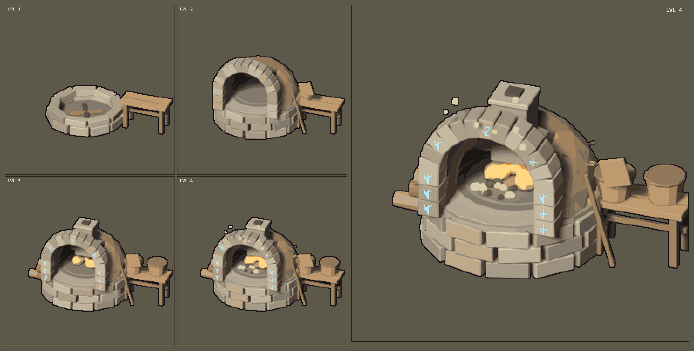

<div align="center">



# Изометрическая печь

**Процедурная модель в Blender → ортографический рендер → пиксель-арт спрайты в ограниченной палитре.**

  

</div>

<!-- header:end -->
Пайплайн «процедурная 3D-модель → изометрические спрайты»: печь с четырьмя стадиями прокачки и героем-кадром строится скриптом в Blender, рендерится ортографической камерой и пикселизуется в ограниченную палитру.

## Как это устроено

- **`build_oven.py`** строит модель кодом (bpy + bmesh): каменный подиум, купол, арочный проём, дымоход, ниша для дров. Кладка идёт рядами, длина камня считается по хорде сектора, поэтому щелей нет.
- **Камера:** ортографическая изометрия, модель повёрнута на 26°.
- **`gen_runes.py`** генерирует текстуры рун для верхних стадий.
- **`pixelate.py`** уменьшает рендер, приводит его к палитре и собирает атлас `sheet.png`.

## Запуск

В Blender (Scripting → Python Console):

```python
exec(open(r"<путь>/oven-iso/build_oven.py", encoding="utf-8").read())
build_all(); setup_stage(); render_all()
```

Затем:

```bash
python pixelate.py
```

> В `build_oven.py` путь к проекту прописан в `ROOT`; поправь его под свою машину.
